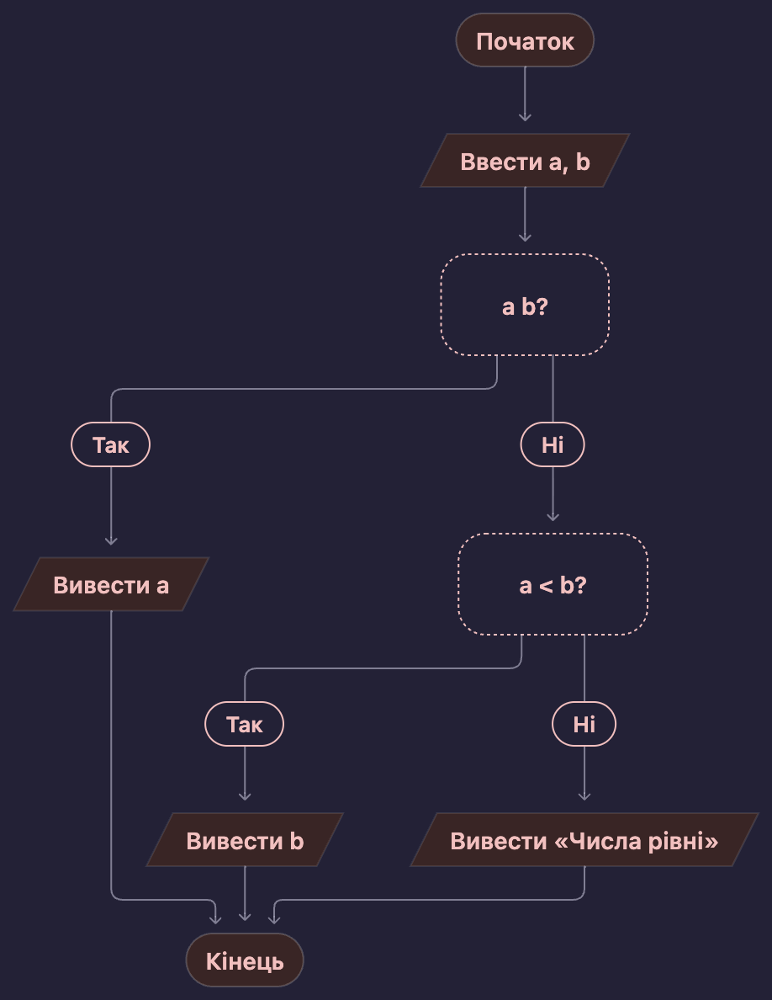

# Назва завдання N1 Площа прямокутника

## Умова
Що потрібно зробити: знайти площу прямокутника

## Вхідні дані
Що користувач вводить: дві сторони прямокутника a i b
Тип даних: double
Допустимі значення та обмеження: a > 0, b > 0

## Вихідні дані
Що програма повинна вивести: Площа прямокутника або повідомлення про помилку, якщо хоча б одна сторона менша або дорівнює нулю.

## Приклад
1). Вхід: 3 4 
Очікуваний вихід: 12
2). вхід 2.5 4
Очікуваний вихід 10 
3). вхід 5 5
Очікуваний вихід 25 це квадрат 
4). вхід -3 4
Очікуваний вихід відємна сторон не допускається  
## Алгоритм розв’язання
1. Ввести сторони a і b.
2. Перевірити, чи хоча б одна сторона менша або дорівнює нулю:
   - Якщо так — вивести повідомлення про помилку.
   - Інакше — обчислити S = a * b та вивести S.
3. Завершити алгоритм.
## Особливі випадки
Що потрібно перевірити або обробити окремо: нульва або відємна сторона не допускається

# Назва завдання N2 «Порівняння двох чисел»
# Умова порівняти 2 числа
## Вхдіні дані
водимо два числа a і b.
Тип даних: double.
Допускаються додатні, від’ємні числа та нуль.

## Вихідні дані 
Якщо числа різні — вивести більше з них.
Якщо рівні — вивести повідомлення «Числа рівні».
# Алгоритм 
1. Ввести a і b.
2. Якщо a > b — вивести a.
3. Інакше, якщо a < b — вивести b.
4. Інакше — повідомити «числа рівні».
5. Завершити алгоритм.
## Приклади

1. Вхід: 8 3
   Очікуваний вихід: 8

2. Вхід: 5 5
   Очікуваний вихід: числа рівні

3. Вхід: -9 -4
   Очікуваний вихід: -4

4. Вхід: 0 -2
   Очікуваний вихід: 0 

